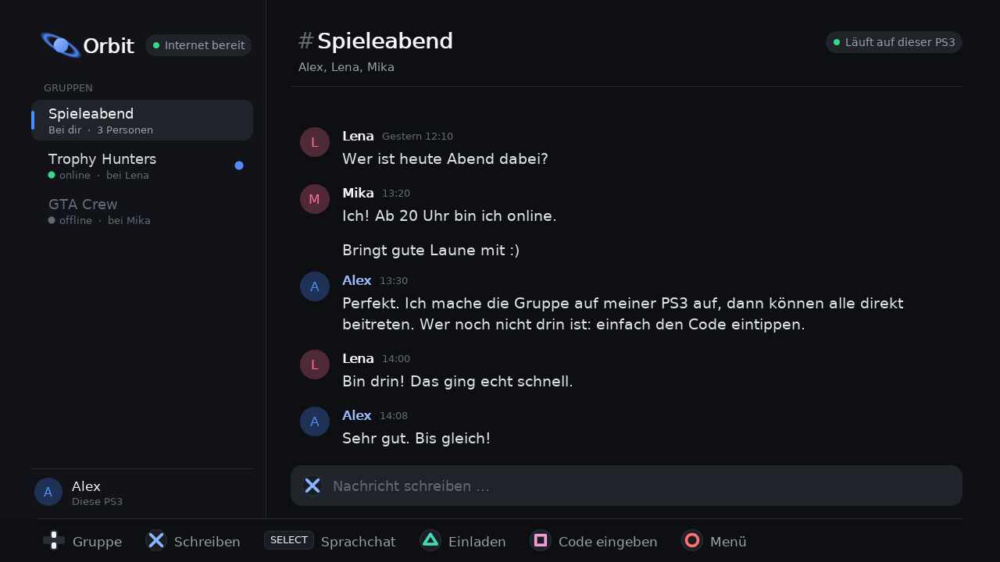
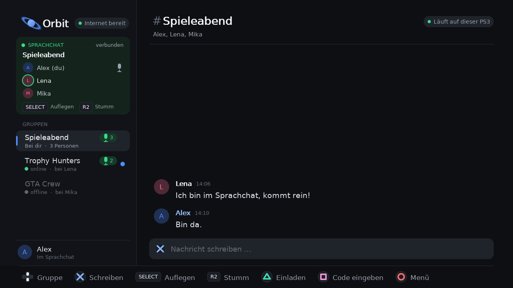

<div align="center">


# ORBIT

**Text & voice chat for PlayStation 3 – no PSN, no account, no router setup.**


**[🇩🇪 Deutsch](#de) · [🇬🇧 English](#en) · [🇫🇷 Français](#fr) · [🇪🇸 Español](#es)**


</div>

<p align="center">
  
  
</p>

> 🌍 **Languages:** The app itself is currently **German only**. More languages are planned –
> Orbit will pick the language automatically from your PS3 system settings.

---

<a id="de"></a>

## 🇩🇪 Deutsch

**🚧 In aktiver Entwicklung – Orbit wächst. Die PS4 ist als Nächstes dran.**

Orbit ist ein Homebrew-Chat für die PS3 mit Text- und Sprachchat. Konsolen verbinden sich direkt miteinander.
Gruppen, Sprachchat und Verlauf liegen auf euren eigenen Konsolen, nicht auf fremden Servern.
**Ein Code, und ihr seid verbunden.**

### ✨ Was Orbit kann
- **Gruppen** wie bei Discord, jede mit eigenem Verlauf, Uhrzeiten und Ungelesen-Punkt
- **Sprachchat** mit **SELECT**, Sprech-Anzeige mit grünem Ring, **R2** für stumm
- **Einladung per 20-Zeichen-Code**. Tippfehler werden erkannt.
- **Kein Konto, kein Passwort**. Beim ersten Start nur den Namen bestätigen.
- **Selbes WLAN:** Die Konsolen finden sich automatisch
- **Internet ohne Router-Einstellungen:** Orbit öffnet selbst einen Tunnel, kein PC nötig
- **Alles wird gespeichert**, und nach Neustart oder Abbruch verbindet sich Orbit automatisch wieder
- Eigene **Bildschirmtastatur** mit Umlauten, ohne abgedunkelten Bildschirm
- Cleanes Design mit **PlayStation-Tastensymbolen** und **animiertem Intro**
- **Ende-zu-Ende verschlüsselt** (TLS)

### ⚔️ Orbit vs. normaler PS3-Chat
| | PS3-Chat (PSN) | Orbit |
|---|---|---|
| PSN-Konto nötig | ja | **nein** |
| Mit CFW/HEN ohne PSN | meist nein | **ja** |
| Abhängig von Sonys Servern | ja | **nein** |
| Freund hinzufügen | Online-ID, Anfrage, bestätigen | **Code eintippen** |
| Wer redet gerade? | kaum erkennbar | **grüner Ring** |
| Ende-zu-Ende verschlüsselt | nein | **ja** |

### ⚡ Schnellstart
1. Die `.pkg` aus den **Releases** auf beiden PS3 installieren und Orbit starten.
2. **✕** Gruppe erstellen → **△** → Code an deinen Freund schicken.
3. Freund: **□** → Code eintippen. Fertig. **SELECT** = Sprachchat.

### 🎮 Tasten
↑↓ Gruppe · ✕ Schreiben · SELECT Sprachchat · R2 Stumm · △ Einladen · □ Code eingeben · ○ Menü ·
L1/R1 Blättern · R3 FPS · START Beenden

### ⚠️ Grenzen
- Orbit muss auf der Gastgeber-PS3 **geöffnet** sein. Das XMB über die PS-Taste ist okay.
- Auf der PS3 **kein Sprachchat im Spiel** und **kein Ton über den DualSense**.
- Übers Internet wird der kostenlose Dienst **bore.pub** genutzt (ohne Garantie). Im WLAN klappt es immer.

### 🚀 Roadmap (geplant, noch nicht enthalten)
- 🎮 **Orbit für PS4 (GoldHEN):** Cross-Chat PS3 ↔ PS4, Ton übers Controller-Headset, DualSense wird geprüft,
  **Spiel-Übertragung** als Ziel
- 🌍 **Mehrere Sprachen** (Englisch, Französisch, Spanisch …), automatisch nach PS3-Systemsprache
- 👤 **Profil anpassen:** Profilbild/Farben, Status, Bio, Lieblingsspiel
- 🛰️ **Server anpassen:** eigener Server per **IP** oder **QR-Code**, mehrere Server, Ping-Anzeige
- ✨ Reaktionen, Benachrichtigungen, Gruppen-Icons, Themes

---

<a id="en"></a>

## 🇬🇧 English

**🚧 In active development – Orbit keeps growing. PS4 is next.**

Orbit is a homebrew chat app for PS3 with text and voice chat. Consoles connect directly to each other.
Groups, voice chat and history live on your own consoles, not on someone else's servers.
**One code and you're connected.**

### ✨ Features
- **Groups** like on Discord, each with its own history, timestamps and unread dot
- **Voice chat** with **SELECT**, a green ring shows who is talking, **R2** to mute
- **Invite with a 20-character code**. Typos are detected.
- **No account, no password**. Just confirm your name on first start.
- **Same Wi-Fi:** consoles find each other automatically
- **Internet without router setup:** Orbit opens its own tunnel, no PC required
- **Everything is saved**, and Orbit reconnects automatically after a restart or a dropped connection
- Built-in **on-screen keyboard**, no dimmed screen while typing
- Clean design with **PlayStation button glyphs** and an **animated intro**
- **End-to-end encrypted** (TLS)

### ⚔️ Orbit vs. the regular PS3 chat
| | PS3 chat (PSN) | Orbit |
|---|---|---|
| PSN account required | yes | **no** |
| Works on CFW/HEN without PSN | mostly no | **yes** |
| Depends on Sony's servers | yes | **no** |
| Adding a friend | Online ID, request, accept | **type a code** |
| Who is talking? | hard to tell | **green ring** |
| End-to-end encrypted | no | **yes** |

### ⚡ Quick start
1. Install the `.pkg` from **Releases** on both PS3s and start Orbit.
2. **✕** create a group → **△** → send the code to your friend.
3. Friend: **□** → type the code. Done. **SELECT** = voice chat.

### 🎮 Controls
↑↓ group · ✕ write · SELECT voice chat · R2 mute · △ invite · □ enter code · ○ menu ·
L1/R1 scroll · R3 FPS · START quit

### ⚠️ Limitations
- Orbit must be **open** on the host PS3. The XMB via the PS button is fine.
- On PS3: **no voice chat in-game** and **no audio through the DualSense**.
- Over the internet Orbit uses the free service **bore.pub** (no guarantee). On the same Wi-Fi it always works.

### 🚀 Roadmap (planned, not included yet)
- 🎮 **Orbit for PS4 (GoldHEN):** PS3 ↔ PS4 cross-chat, audio through the controller headset, DualSense support
  being evaluated, **game streaming** as a goal
- 🌍 **More languages** (English, French, Spanish …), picked automatically from the PS3 system language
- 👤 **Profile customization:** picture/colors, status, bio, favorite game
- 🛰️ **Server settings:** your own server via **IP** or **QR code**, multiple servers, ping display
- ✨ Reactions, notifications, group icons, themes

---

<a id="fr"></a>

## 🇫🇷 Français

**🚧 En développement actif – Orbit continue de grandir. La PS4 est la prochaine étape.**

Orbit est une application homebrew de chat pour PS3, avec chat texte et chat vocal. Les consoles se connectent
directement entre elles. Les groupes, le chat vocal et l'historique restent sur vos propres consoles, pas sur des
serveurs tiers. **Un code, et vous êtes connectés.**

### ✨ Fonctionnalités
- **Groupes** comme sur Discord, chacun avec son historique, l'heure des messages et un point « non lu »
- **Chat vocal** avec **SELECT**, un anneau vert montre qui parle, **R2** pour couper le micro
- **Invitation avec un code de 20 caractères**. Les fautes de frappe sont détectées.
- **Pas de compte, pas de mot de passe**. Il suffit de confirmer son nom au premier lancement.
- **Même Wi-Fi :** les consoles se trouvent automatiquement
- **Internet sans configurer la box :** Orbit ouvre son propre tunnel, aucun PC nécessaire
- **Tout est sauvegardé**, et Orbit se reconnecte automatiquement après un redémarrage ou une coupure
- **Clavier virtuel** intégré, l'écran n'est pas assombri pendant la saisie
- Design épuré avec les **symboles des touches PlayStation** et une **intro animée**
- **Chiffrement de bout en bout** (TLS)

### ⚔️ Orbit vs. le chat PS3 classique
| | Chat PS3 (PSN) | Orbit |
|---|---|---|
| Compte PSN requis | oui | **non** |
| Fonctionne en CFW/HEN sans PSN | rarement | **oui** |
| Dépend des serveurs de Sony | oui | **non** |
| Ajouter un ami | ID en ligne, demande, acceptation | **saisir un code** |
| Qui parle ? | difficile à voir | **anneau vert** |
| Chiffré de bout en bout | non | **oui** |

### ⚡ Démarrage rapide
1. Installez le `.pkg` des **Releases** sur les deux PS3 et lancez Orbit.
2. **✕** créer un groupe → **△** → envoyez le code à votre ami.
3. Ami : **□** → saisir le code. C'est tout. **SELECT** = chat vocal.

### 🎮 Commandes
↑↓ groupe · ✕ écrire · SELECT chat vocal · R2 couper le micro · △ inviter · □ saisir un code · ○ menu ·
L1/R1 défiler · R3 FPS · START quitter

### ⚠️ Limites
- Orbit doit être **ouvert** sur la PS3 hôte. Le XMB via la touche PS ne pose pas de problème.
- Sur PS3 : **pas de chat vocal en jeu** et **pas de son dans la DualSense**.
- Sur Internet, Orbit utilise le service gratuit **bore.pub** (sans garantie). En Wi-Fi local, ça marche toujours.

### 🚀 Feuille de route (prévu, pas encore inclus)
- 🎮 **Orbit pour PS4 (GoldHEN) :** chat croisé PS3 ↔ PS4, son via le casque de la manette, prise en charge de la
  DualSense à l'étude, **diffusion du jeu** comme objectif
- 🌍 **Plusieurs langues** (anglais, français, espagnol …), choisies automatiquement selon la langue de la PS3
- 👤 **Profil personnalisable :** photo/couleurs, statut, bio, jeu préféré
- 🛰️ **Réglages serveur :** votre propre serveur par **IP** ou **QR code**, plusieurs serveurs, affichage du ping
- ✨ Réactions, notifications, icônes de groupe, thèmes

---

<a id="es"></a>

## 🇪🇸 Español

**🚧 En desarrollo activo – Orbit sigue creciendo. La PS4 es lo siguiente.**

Orbit es una aplicación homebrew de chat para PS3, con chat de texto y de voz. Las consolas se conectan
directamente entre sí. Los grupos, el chat de voz y el historial quedan en vuestras propias consolas, no en
servidores ajenos. **Un código y ya estáis conectados.**

### ✨ Funciones
- **Grupos** como en Discord, cada uno con su historial, hora de los mensajes y punto de « no leído »
- **Chat de voz** con **SELECT**, un anillo verde muestra quién habla, **R2** para silenciar
- **Invitación con un código de 20 caracteres**. Se detectan los errores de escritura.
- **Sin cuenta, sin contraseña**. Solo hay que confirmar el nombre al iniciar por primera vez.
- **Misma Wi-Fi:** las consolas se encuentran automáticamente
- **Internet sin configurar el router:** Orbit abre su propio túnel, no hace falta un PC
- **Todo se guarda**, y Orbit se reconecta automáticamente tras un reinicio o un corte
- **Teclado en pantalla** propio, la pantalla no se oscurece al escribir
- Diseño limpio con **símbolos de los botones de PlayStation** e **intro animada**
- **Cifrado de extremo a extremo** (TLS)

### ⚔️ Orbit vs. el chat normal de PS3
| | Chat de PS3 (PSN) | Orbit |
|---|---|---|
| Cuenta PSN necesaria | sí | **no** |
| Funciona con CFW/HEN sin PSN | casi nunca | **sí** |
| Depende de los servidores de Sony | sí | **no** |
| Añadir un amigo | ID online, solicitud, aceptar | **escribir un código** |
| ¿Quién está hablando? | difícil de ver | **anillo verde** |
| Cifrado de extremo a extremo | no | **sí** |

### ⚡ Inicio rápido
1. Instala el `.pkg` de **Releases** en las dos PS3 e inicia Orbit.
2. **✕** crear grupo → **△** → envía el código a tu amigo.
3. Amigo: **□** → escribe el código. Listo. **SELECT** = chat de voz.

### 🎮 Controles
↑↓ grupo · ✕ escribir · SELECT chat de voz · R2 silenciar · △ invitar · □ introducir código · ○ menú ·
L1/R1 desplazarse · R3 FPS · START salir

### ⚠️ Limitaciones
- Orbit debe estar **abierto** en la PS3 anfitriona. El XMB con el botón PS no es problema.
- En PS3: **sin chat de voz dentro de los juegos** y **sin sonido por el DualSense**.
- Por Internet, Orbit usa el servicio gratuito **bore.pub** (sin garantía). En la misma Wi-Fi siempre funciona.

### 🚀 Hoja de ruta (planeado, aún no incluido)
- 🎮 **Orbit para PS4 (GoldHEN):** chat cruzado PS3 ↔ PS4, sonido por los auriculares del mando, soporte para
  DualSense en estudio, **transmisión de juego** como objetivo
- 🌍 **Más idiomas** (inglés, francés, español …), elegidos automáticamente según el idioma de la PS3
- 👤 **Perfil personalizable:** foto/colores, estado, bio, juego favorito
- 🛰️ **Ajustes de servidor:** tu propio servidor por **IP** o **código QR**, varios servidores, indicador de ping
- ✨ Reacciones, notificaciones, iconos de grupo, temas

---

## 🛠️ Building from source

Requirements: Linux or WSL, the [ps3dev](https://github.com/ps3dev/ps3dev) toolchain with PSL1GHT and the
portlibs (FreeType, libpng, zlib, mbedTLS), Python 3. By default the Makefile expects the toolchain in
`../build-tools/ps3dev` and mbedTLS 2.28 in `../build-tools/mbedtls-2.28.10`. Set `PS3DEV` to use another location.

```bash
make ps3                    # build/orbit.elf
bash tools/package.sh       # build/Orbit-PS3-<version>.pkg (+ previews and package checks)
make test                   # desktop protocol, storage and app tests
bash tools/test_relay.sh    # full app test through the optional relay
bash tools/test_tunnel.sh   # full app test through the built-in tunnel (local bore stand-in)
bash tools/test_nat.sh      # router opening (UPnP, PCP, CGNAT, FRITZ!Box) against a simulated router
```

Optional: put an address into `relay.txt` (for example `203.0.113.5`) before packaging to ship a default
relay. The relay server is in `relay/` (`orbit_relay.py`, standard library only; `install.sh` for Linux servers).

### Project structure
| Path | Contents |
|---|---|
| `src/` | App core, renderer, network, voice, tunnel, relay client, PS3 main loop |
| `include/` | Headers |
| `vendor/` | cJSON, Monocypher, PS3 import stubs and third-party licenses |
| `assets/` | Font, PARAM.SFO template, logo |
| `relay/` | Optional relay server (Python) and install script |
| `tests/`, `tools/` | Tests, simulators, preview renderer, packaging |
| `docs/` | Screenshots and intro preview |

## 📄 License

Orbit is licensed under **GPL-3.0-or-later** (see [LICENSE](LICENSE)). It includes code from PSL1GHT samples
(GPL-3.0) and third-party libraries listed in [THIRD-PARTY.md](THIRD-PARTY.md).

Orbit is an independent homebrew project and is **not affiliated with or endorsed by Sony Interactive
Entertainment**. "PlayStation", "PS3", "PS4", "PS5", "DualSense" and the button symbols are trademarks of their
respective owners; Orbit only draws its own versions of the symbols.

<div align="center">

**Made for the PS3 community. Ideas and feedback welcome. 🪐**

</div>
